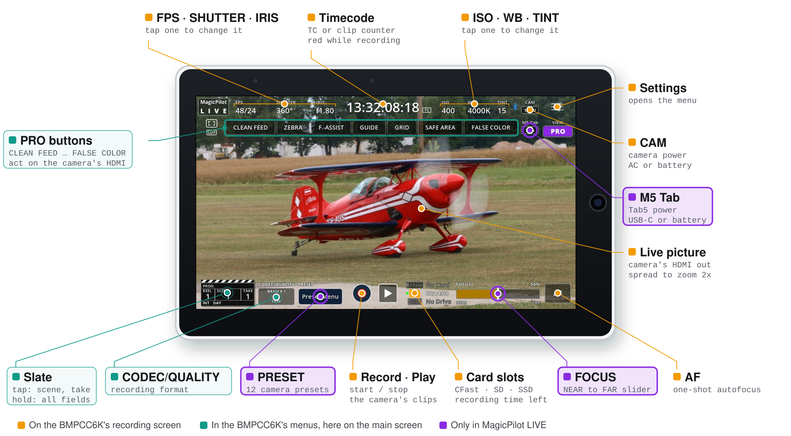
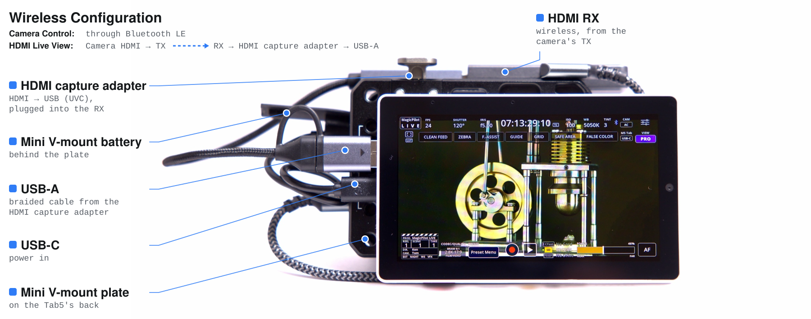
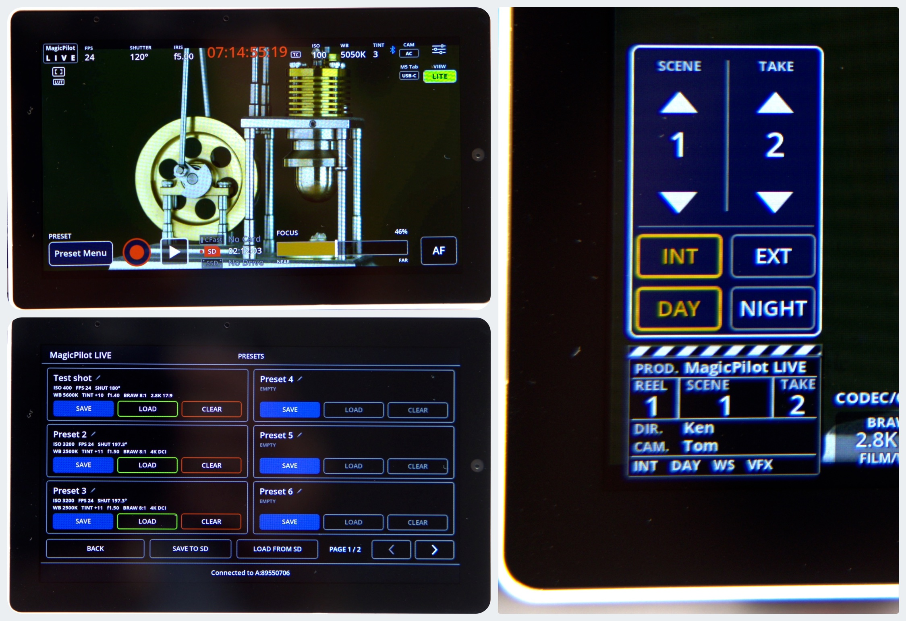
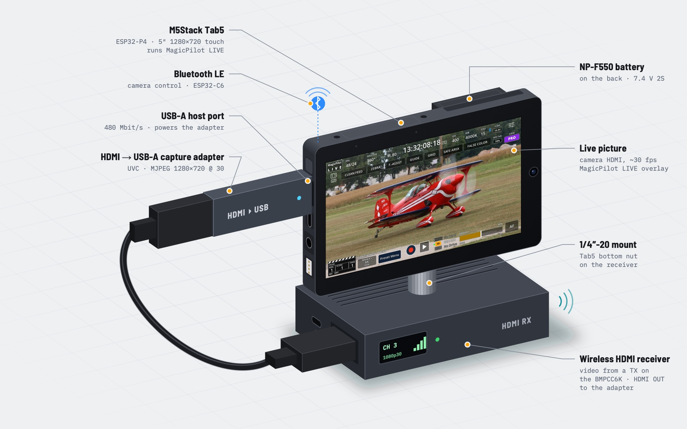
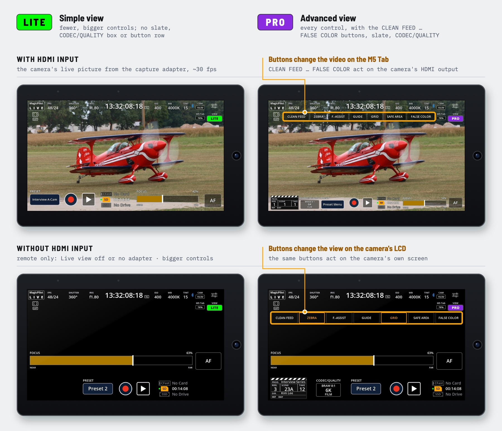

# ✨ MagicPilot LIVE: Wired or Wireless Monitor & Bluetooth Remote for Blackmagic Pocket Cinema Cameras

### 🎬 A touchscreen monitor and remote for Blackmagic cameras that puts settings hidden in the camera's menus on the main screen, one tap away. About $80 wired or $120 wireless, built on the M5Stack Tab5 (ESP32-P4) and tested with the BMPCC6K.

🌐 **Website:** [kenfilms.github.io/MagicPilot_Live](https://kenfilms.github.io/MagicPilot_Live/)




*PRO view over the camera's live HDMI picture, drawn by the firmware's own UI code.*

MagicPilot LIVE turns an **M5Stack Tab5** into a monitor and touch remote for the
**Blackmagic Pocket Cinema Camera 6K**: the camera's live HDMI picture, with the camera's settings
laid over it. Tap a setting to change it over Bluetooth LE, using the Blackmagic Camera Control
protocol of [MagicPilot_Remote](https://github.com/KenFilms/MagicPilot_Remote).

**Everything on the main screen.** Many settings that the BMPCC6K keeps in its menus are right on
MagicPilot LIVE's main screen, one tap away: codec and quality, the slate, clean feed, zebra, focus assist,
false colour and guides. Camera presets and the NEAR → FAR focus slider aren't on the camera at all.
You change them while you watch the picture, instead of digging through menus.

No phone, no Wi-Fi, no Blackmagic Camera app.



*The wireless configuration: the hardware on the Tab5, labelled.*

## At a glance

| | Feature | What it does |
|---|---|---|
| 📺 | **Live picture** | The camera's HDMI output, full screen in landscape, 30 fps, or a remote-only mode without it. |
| 📊 | **Camera status** | FPS, shutter, iris, timecode, ISO, white balance, tint, LUT, recording and card slots, like on the camera. |
| 💾 | **Camera presets** | 12 named presets, as in MagicPilot_Remote, kept on the Tab5. |
| 🎬 | **Slate** | The camera's slate: scene, take, shot type, project, lens data. |
| 🎯 | **Focus** | Focus slider and one-shot autofocus. |
| 🎥 | **Record** | Start and stop recording. |
| ⚙️ | **Record settings** | Codec, resolution, dynamic range, frame rates, sharpening. |
| 📐 | **Display tools** | Frame guides, grid, safe area, brightness. |
| 🔗 | **Pairing** | Asks for the camera's PIN once, then reconnects automatically. |



*LITE view while recording, the presets page, and the quick slate.*

## Hardware



- **M5Stack Tab5** (ESP32-P4). Tested: board version 3, ESP32-C6 with its factory firmware.
- **HDMI to USB capture adapter** (UVC, MJPEG, e.g. MS2109 or MS2130 sticks) in the Tab5's **USB-A**
  port, on an HDMI cable from the camera, or through a wireless HDMI transmitter and receiver.
  Optional: with *Settings → REMOTE → Live view → Off (remote only)* the Tab5 is a Bluetooth remote
  without it and leaves the USB-A port unpowered.
- **Blackmagic Pocket Cinema Camera 6K** with Bluetooth on. The Tab5 switches the camera's status
  text off on HDMI; if it still shows, switch the HDMI overlays off on the camera (*Monitor → HDMI*).

**Cost** (without the camera and without the M5 Tab battery): about **$80** wired (Tab5, capture adapter and
HDMI cable), or about **$120** wireless (with an HDMI transmitter and receiver).

### Camera compatibility

The live picture works with any camera that has an HDMI output. Camera control uses the Blackmagic
Camera Control Bluetooth protocol that Blackmagic's Bluetooth cameras share, but only the BMPCC6K is
tested.

| Camera | Status | Notes |
|---|---|---|
| Pocket Cinema Camera 6K (BMPCC6K) | 🟢 Tested | |
| Pocket Cinema Camera 6K G2 / 6K Pro | 🟡 Not tested | Same sensor and modes as the 6K: very likely to work as is |
| Pocket Cinema Camera 4K (BMPCC4K) | 🟡 Not tested | Status and controls should work; the format menu lists the 6K's modes |
| Other Blackmagic cameras with Bluetooth | 🟡 Not tested | Basic control should work; resolutions, frame-rate limits and media slots need adapting |

Specific to the BMPCC6K: the resolutions and frame-rate limits (`UI_RESOLUTIONS` in
`main/ui_draw.c`), the CFast, SD and USB-C drive slots, and the settings it refuses over Bluetooth:
switching between BRAW and ProRes, ProRes resolutions, Film dynamic range and the LUT. It also
doesn't send card names, capacity, audio levels, custom white balance, zebra, focus assist, false
colour or playback, so the Tab5 can't show them. Reports from other cameras are welcome.

## Build and flash

PlatformIO (pioarduino platform):

```sh
pio run -t upload --upload-port /dev/cu.usbmodemXXXX
pio device monitor
```

or ESP-IDF ≥ 5.5.3:

```sh
idf.py set-target esp32p4
idf.py build flash monitor
```

If PlatformIO reports *"Python's lzma module is unavailable"*, run `brew install xz`.
`sdkconfig.m5stack-tab5` is generated from `sdkconfig.defaults`: delete it after changing the defaults.

## Using the remote

**Pairing.** The Tab5 looks for the camera at power-on and whenever the link drops. The first time,
it asks for the 6-digit PIN from the BMPCC6K Setup Menu, page 6.

### Views

The VIEW button switches between LITE and PRO (advanced). With live view off, or without the capture
adapter, the Tab5 is a Bluetooth remote with bigger controls. With HDMI input, the CLEAN FEED … FALSE
COLOR buttons act on the camera's HDMI output, so they change the video on the Tab5; without it, they
change the view on the camera's own LCD.



The screens are the firmware's own drawing code, rendered with `tools/preview` over an example picture.

### Screen

| Area | Shows | Tap |
|---|---|---|
| Frame icon | `LUT` below it while the camera's display LUT is on | Display tools |
| FPS, SHUTTER, IRIS, ISO, WB, TINT | The camera's values (`48/24`: off-speed sensor/project rate) | Panel |
| Timecode | Timecode (`TC`) or clip counter, red while recording | Timecode ↔ clip |
| Bluetooth symbol | Blue while connected | Menu, REMOTE tab |
| CAM badge | Camera power: `AC` or battery voltage | `AC` ↔ voltage |
| M5 Tab badge | `USB-C` on outside power, otherwise the Tab5's battery | Percentage ↔ voltage |
| Settings icon | | Menu, RECORD tab |
| Button row (PRO) | CLEAN FEED, ZEBRA, F.-ASSIST, GUIDE, GRID, SAFE AREA, FALSE COLOR, outlined in yellow when on | Switches them on the camera (HDMI, or the LCD without live view). Clean feed greys out the others. No LUT button: the LUT can't be switched over Bluetooth |
| VIEW button | *LITE* on green, *PRO* on violet | Switches the view |
| Slate | The camera's slate as a clapperboard | Tap: scene, take, INT/EXT, DAY/NIGHT; hold: every field |
| Film icon | Codec and quality, resolution, dynamic range (*FILM/VIDEO* while the display LUT is on) | Menu, RECORD tab |
| PRESET button | *Preset Menu*, or the loaded preset's name | [Presets](#presets) |
| Record button | Red ring while recording | Start / stop |
| Card slots | CFast, SD and SSD (the USB-C drive) with the recording time left, or *No Card* / *No Drive* | |
| ▶ | Play clip | The camera's clips |
| FOCUS, AF | Focus slider from NEAR to FAR, autofocus | [Focus](#focus-and-zoom) |

### Presets

The presets page holds 12 presets, each with a name, ISO, shutter, frame rates (with off-speed),
white balance and tint, iris, codec and quality, and resolution. A preset from the other codec (BRAW
or ProRes), or a ProRes resolution, says so, as the camera only changes those on its own menu.

**SAVE TO SD** writes them to `MPLIVE/PRESETS.TXT` on a FAT32 microSD card, as readable JSON.
Cards above 32 GB come as exFAT and need formatting as FAT32 first.

### Focus and zoom

The focus slider starts at 50 % on every connection, as the camera doesn't report the lens position;
moving it moves the lens by the same amount. **AF** runs the camera's one-shot autofocus.

Spread two fingers on the picture to zoom in 2x on that spot; drag to move, pinch or tap the yellow
**2x** badge to zoom out.

### Display tools

Frame guides (2.40:1 … 1:1, mask opacity), grid (thirds, centre cross or both) and safe area
(5–100 %) are the camera's own, in its HDMI picture. Backlight brightness is the Tab5's own. The
camera draws grid and safe area only where they are switched on in its monitor menu, which Bluetooth
can't reach: switch Grid and Safe Area on for HDMI on the camera once.

## Configuration

`pio run -t menuconfig` / `idf.py menuconfig` → *MagicPilot LIVE*

| Option | Default | Meaning |
|---|---|---|
| Preferred capture width/height/fps | 1280x720 @ 30 | Requested from the adapter (60 fps lowers lag) |
| Scaling mode | Fill | *Fill* covers the screen, *Fit* letterboxes |
| Landscape orientation | 90° | 270° if the picture is upside down |
| Turn touch input by 180 degrees | off | If taps land on the opposite side |
| Swap red/blue of MJPEG | off | If colours look wrong |
| Grid line width / Display backlight | 2 px / 100 % | |
| Performance → Frame pacing | Auto | Even frame cadence |
| Performance → Render in bands through internal SRAM | on | ~2x faster render |

## Picture, frame rate and lag

- The adapter's best MJPEG format is used, preferably 1280x720 (1:1 on the screen), up to 1920x1080.
  Hot-plug works; without a picture the camera UI shows on black.
- Measured at 1280x720 @ 30: 30.0 fps shown, no frames dropped; decode ~16 ms, render ~26–29 ms.
- Most of the lag is the capture adapter (cheap ones buffer 1–3 frames). Capturing at 60 fps lowers
  it even though about 30 fps are shown.

## How it works

```
HDMI ─► capture adapter ─► USB ─► JPEG decoder ─► GDMA bands → SRAM ─► camera UI ─► PPA rotate ─► display
BMPCC6K ◄─ Bluetooth LE ─► ESP32-C6 (controller) ◄─ SDIO, ESP-Hosted ─► ESP32-P4 (Bluedroid host)
```

- **Bluetooth.** The ESP32-P4 has no radio: the Tab5's ESP32-C6 runs the controller over SDIO with
  `espressif/esp_hosted` 2.12.13, on its factory firmware. Writes go through a queue that keeps the
  newest value of a dragged slider.
- **Picture.** The PPA reads PSRAM slowly, so the GDMA copies 32-row bands into internal SRAM, both
  cores composite the camera UI into each band, and the PPA rotates it onto the portrait panel.
- **Camera UI.** `ui_draw.c` draws into a 1280x720 canvas and `overlay.c` run-length encodes the
  changed rows, so compositing costs ~2–3 ms per frame.
- **Vendored:** `components/usb_host_uvc` (2.6.0, fixed for MacroSilicon adapters) and
  `components/m5stack_tab5_noglib` (BSP 1.3.2 with a 60 Hz panel refresh).

## Development

| Path | Content |
|---|---|
| `main/main.c` | Capture, decode, band renderer, pacing |
| `main/cam_ble.c` | Bluetooth link, pairing, write queue |
| `main/cam.c`, `cam_fmt.c` | Camera state, packets, commands, value formatting |
| `main/ui.c`, `ui_draw.c` | Touch and actions; layout, drawing and hit testing |
| `main/overlay.c`, `gfx.c`, `fonts.c` | Canvas and compositing, drawing primitives, fonts |
| `main/tab5_bat.c` | Tab5 battery (INA226) |
| `tools/preview/` | Desktop preview: `render.py <image> <out_dir>` writes PNGs of every screen |
| `tools/check/` | `check.py` compares every preview screen, every touch area and every Bluetooth packet with `tools/check/ref` (`--update` accepts the changes) |

Fonts: Open Sans (SIL Open Font License 1.1), converted by `tools/gen_fonts.py`.

## Disclaimer

⚠️ Use at your own risk. MagicPilot LIVE is provided "as is" without warranty. The developer is
not responsible or liable for damage, malfunction, loss of footage, data loss, or any other loss or
damage to cameras, lenses, recording media, accessories, equipment, or property resulting from the
use of this software or firmware. Always verify settings, compatibility, and operation before using
it with valuable or professional equipment.

MagicPilot LIVE is an independent open-source project and is not affiliated with, endorsed
by, or sponsored by Blackmagic Design Pty. Ltd. Blackmagic Design, Blackmagic Pocket Cinema Camera,
BMPCC, and related names and trademarks are the property of Blackmagic Design Pty. Ltd.
